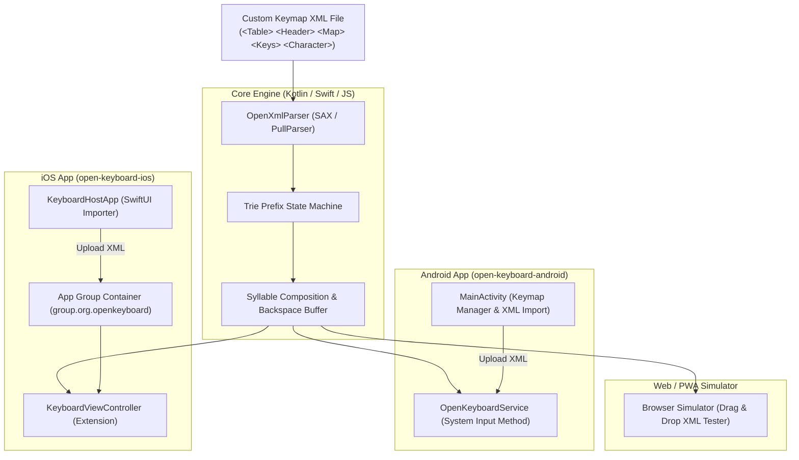

# Open Keyboard ⌨️

[](https://opensource.org/licenses/MIT)
[](android/)
[](ios/)
[](keymaps/)
[](web-simulator/index.html)

**Open Keyboard** is a universal, open-source keyboard application and system Input Method for **Android**, **iOS**, and the **Web**.

It provides an open, XML-driven keyboard architecture where **anyone can design, upload, and use custom keyboard layouts for any Indian or European language**.

---

## 🌍 Supported Language Ecosystems

### 🇮🇳 Indian Languages
* **Tamil:** Featuring **Tamil26ADN (by SIVA)**, Tamil26, Unicode Phonetic, Tamil99, Bamini, Inscript, Old Typewriter, Shrilipi, Vanavil, TSCII, TAB, TAM, and Brahmi.
* **Hindi / Devanagari:** Phonetic transliteration and standard layouts.
* **Telugu:** Phonetic transliteration layouts.
* **Kannada, Malayalam, Bengali, Gujarati, Punjabi, Odia, Marathi, Sanskrit:** Easily extensible with custom community XMLs.

### 🇪🇺 European Languages
* **French:** Diacritics and accents (`é`, `è`, `ê`, `ë`, `ç`, `à`, `ù`, `œ`).
* **German:** Umlauts and Eszett (`ä`, `ö`, `ü`, `ß`).
* **Spanish:** Accents and inverted punctuation (`á`, `é`, `í`, `ó`, `ú`, `ñ`, `¿`, `¡`).
* **Russian:** Cyrillic QWERTY transliteration (`а`, `б`, `в`, `г`, `д`, etc.).
* **Custom Alphabets & Phonetics:** Create phonetic or ergonomic layouts for Greek, Italian, Portuguese, Swedish, Esperanto, etc.

---

## ✨ Key Features

* **Universal XML Keymap Engine:** Any user can define key sequences and target character outputs using clean XML definitions.
* **Featured Layout - Tamil26ADN:** Pre-configured with the ergonomic 26-key Tamil layout created by **SIVA**.
* **Upload Custom XML:** Direct file upload on mobile (Downloads, iCloud, Google Drive) and instant activation across the whole phone (WhatsApp, Chrome, Notes, SMS, etc.).
* **Android System IME:** Native Kotlin `InputMethodService` with haptic feedback, syllable composition, and hardware/Bluetooth keyboard support.
* **iOS Keyboard Extension:** Native Swift `UIInputViewController` with App Group container file synchronization (`group.org.openkeyboard`).
* **Instant Web Simulator:** Zero-install interactive simulator with drag-and-drop XML validation and character inspector.

---

## 🏛 Architecture



---

## 📂 Repository Structure

```
open-keyboard/
├── keymaps/                    # 49 standard and community XML keymap files
│   ├── Tamil26ADN.xml          # Featured 26-Key Tamil Layout by SIVA
│   ├── Tamil 26.xml            # Tamil 26 Layout by SIVA
│   ├── Hindi_Unicode_Phonetic.xml
│   ├── Telugu_Unicode_Phonetic.xml
│   ├── French_Unicode_Diacritics.xml
│   ├── German_Unicode_Umlauts.xml
│   ├── Spanish_Unicode_Accents.xml
│   ├── Russian_Unicode_Translit.xml
│   └── ... (Bamini, Shrilipi, Vanavil, TSCII, Tamil99, etc.)
│
├── android/                    # Android Studio Native Project
│   ├── app/src/main/java/org/openkeyboard/
│   │   ├── engine/             # OpenXmlParser.kt, OpenKeyboardEngine.kt
│   │   ├── service/            # OpenKeyboardService.kt (InputMethodService)
│   │   ├── storage/            # KeymapRepository.kt (file importer & storage)
│   │   └── ui/                 # MainActivity.kt, KeyboardView.kt
│   └── app/src/main/assets/    # Preloaded keymaps
│
├── ios/                        # Xcode Native Project (Swift + SwiftUI)
│   ├── KeyboardHostApp/        # Host companion app with XML file importer
│   ├── KeyboardExtension/      # System Keyboard Extension (UIInputViewController)
│   ├── Shared/                 # Shared OpenKeyboardEngine.swift & OpenXmlParser.swift
│   └── OpenKeyboard.xcodeproj  # Xcode project file
│
├── web-simulator/              # Zero-install HTML5/JS Live Simulator
│   ├── index.html              # Responsive interactive keyboard tester
│   └── bundled_keymaps.js      # Embedded keymap database
│
├── docs/                       # Technical specifications & guides
│   └── XML_KEYMAP_SPECIFICATION.md
│
├── .github/workflows/          # CI workflows for Android & iOS automated builds
│   └── ci.yml
├── LICENSE                     # MIT License
└── README.md
```

---

## ⚡ Instant Testing (Web Simulator)

You can test **Tamil26ADN** and other language keymaps immediately without compiling code:
1. Open [`web-simulator/index.html`](file:///D:/Users/Siva/Desktop/open-keyboard/web-simulator/index.html) in your browser.
2. Select **`[Tamil] Tamil26ADN (Unicode) - by SIVA`** or choose any other Indian/European keymap.
3. Type using your physical keyboard or tap on the virtual touch keys.
4. Drag and drop any custom `.xml` file to test and validate in real-time!

---

## 📱 Android Setup & Build

1. Open the [`android/`](file:///D:/Users/Siva/Desktop/open-keyboard/android) folder in Android Studio.
2. Build and install on your device or emulator:
   ```bash
   ./gradlew installDebug
   ```
3. Open the **Open Keyboard** app on your phone:
   - Tap **"Enable in Settings"** and toggle Open Keyboard on.
   - Tap **"Switch Keyboard"** and select Open Keyboard.
   - Tap **"Upload Custom XML"** to import any `.xml` keymap file!

---

## 🍏 iOS Setup & Build

1. Open [`ios/OpenKeyboard.xcodeproj`](file:///D:/Users/Siva/Desktop/open-keyboard/ios/OpenKeyboard.xcodeproj) in Xcode.
2. Under **Signing & Capabilities**:
   - Assign your Developer Team to `OpenKeyboard` and `KeyboardExtension`.
   - Ensure the App Group `group.org.openkeyboard` is enabled for both targets.
3. Run on your iPhone or Simulator (`Cmd + R`).
4. On your iPhone:
   - Go to **Settings > General > Keyboard > Keyboards > Add New Keyboard...**
   - Select **Open Keyboard**.
   - Tap Open Keyboard and enable **"Allow Full Access"** (required to read user-uploaded XML keymaps).
   - Launch the Open Keyboard app to import new XML files!

---

## 📝 Creating a Custom XML Keymap

```xml
<Table>
    <Header>
        <Language>Tamil</Language>
        <Encoding>Unicode</Encoding>
        <Keyboard>Tamil26ADN</Keyboard>
        <Author>SIVA</Author>
        <Description>Universal 26-Key Layout for Tamil</Description>
    </Header>
    <Data>
        <!-- 'a' (0x61) -> 'த' (U+0BA4) -->
        <Map><Display>0BA4</Display><Character>0BA4</Character><Keys>61</Keys></Map>
        
        <!-- 'aa' (0x6161) -> 'த்த' (U+0BA4 U+0BCD U+0BA4) -->
        <Map><Display>0BA40BCD0BA4</Display><Character>0BA40BCD0BA4</Character><Keys>6161</Keys></Map>
        
        <!-- 'ag' (0x6167) -> 'த்' (U+0BA4 U+0BCD) -->
        <Map><Display>0BA40BCD</Display><Character>0BA40BCD</Character><Keys>6167</Keys></Map>
    </Data>
</Table>
```

See [docs/XML_KEYMAP_SPECIFICATION.md](docs/XML_KEYMAP_SPECIFICATION.md) for complete details.

---

## 📄 License

Distributed under the **MIT License**. See [`LICENSE`](LICENSE) for more information.
